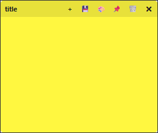

# Sticky Notes


<div align="center">
  
</div>

> Compact, portable sticky-note style notes for your desktop. Built with PyQt6 and integrated with Text List Tool.

## ✨ Features

- 📝 **Quick notes** — create, edit and delete desktop sticky notes
- 🎨 **8 pastel colors** — pick a color for each note
- 🖱️ **Draggable** — move notes anywhere via the custom title bar
- 📌 **Always on top** — keep notes above other windows
- 🏷️ **Editable titles** — click the title to rename a note
- 💾 **Autosave** — notes are stored automatically in `sticky_notes_data.json`
- 🌐 **Bilingual UI** — English / Polish interface strings
- 📐 **Resizable** — built-in size grip on every note

## 🚀 Getting Started

### Prerequisites

- Python 3.10 or newer
- PyQt6

### Installation

```bash
git clone https://github.com/polsoft-its/sticky-notes.git
cd sticky-notes
pip install PyQt6
```

### Usage

```bash
python sticky_notes.py
```

## 📁 Data

All notes are saved locally in `sticky_notes_data.json` next to the script — fully portable, no installation or registry entries required.

## 🤝 Contributing

Pull requests are welcome. For major changes, please open an issue first to discuss what you would like to change.

---

## 👤 Author

**Sebastian Januchowski / polsoft.ITS Group**

- Project: [polsoft.ITS](https://polsoft.its)
- Module: Sticky Notes — part of the Text List Tool suite
